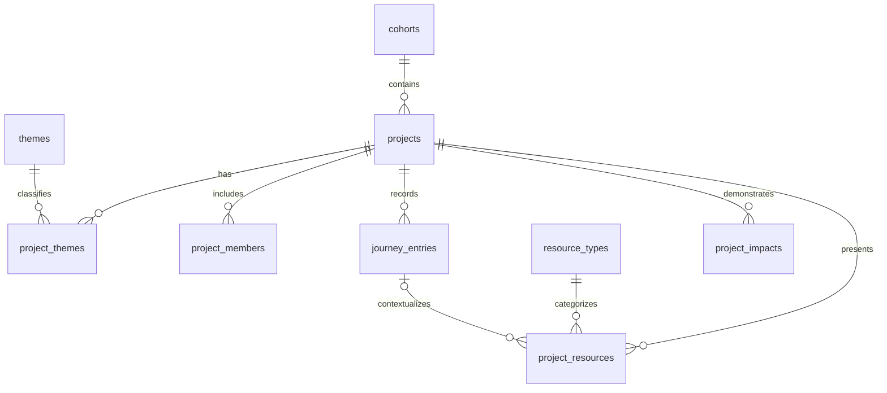

# Dream Journey 数据库设计参考

依据：[Requirements.md](Requirements.md)。本设计以关系型数据库为参考，字段类型采用 PostgreSQL 写法，供后续实现选型使用。

## 1. 设计范围

以项目为核心，支持按届次和主题发现项目、展示研究历程、关联成果、提炼实践建议及呈现影响证据。当前采用人工维护的精选项目机制。

共九张表。成员资料独立于登录账号，适合当前浏览与展示型原型；账号、收藏、评论和投稿审核可在后续扩展。

## 2. 实体关系

一个项目属于一个届次，可关联多个主题、成员、研究阶段、成果和影响记录。一个成果可关联该项目的一个研究阶段，也可只关联项目。

## 3. 表结构

约定：除 `project_themes` 外，每张表都有 `id UUID PRIMARY KEY`、`created_at TIMESTAMPTZ` 和 `updated_at TIMESTAMPTZ`。时间默认取当前时间，`updated_at` 由应用在更新时维护。下列字段默认必填，标注“可空”的除外。

### 3.1 `cohorts`：届次

| 字段 | 类型 | 说明 |
| --- | --- | --- |
| name | TEXT | 届次名称，如“2026 年暑期”，唯一 |
| year | SMALLINT | 年份；允许同一年有多个届次 |
| description | TEXT | 届次介绍，可空 |

### 3.2 `themes`：主题

| 字段 | 类型 | 说明 |
| --- | --- | --- |
| name | TEXT | 主题名称，唯一，如“生态” |
| slug | TEXT | 稳定标识，唯一，如 `ecology` |
| description | TEXT | 主题介绍，可空 |

初始主题包括文化、文化遗产、生态、建筑、博物馆、农业和社区研究。新增主题通过新增记录完成。

### 3.3 `projects`：项目

| 字段 | 类型 | 说明 |
| --- | --- | --- |
| cohort_id | UUID | 外键 → `cohorts.id` |
| title | TEXT | 项目标题 |
| slug | TEXT | 项目页面标识，唯一 |
| summary | TEXT | 简介，用于列表和搜索 |
| location | TEXT | 调研地点，可空 |
| team_name | TEXT | 团队展示名称，可空 |
| cover_url | TEXT | 封面资源地址，可空 |
| research_question | TEXT | 核心研究问题 |
| research_methods | TEXT | 研究方法概述 |
| learning_outcomes | TEXT | 学习收获 |
| practical_tips | TEXT | 可借鉴的调研方法和实践建议 |
| status | TEXT | `draft`、`published`、`archived`，默认 `draft` |
| published_at | TIMESTAMPTZ | 发布时间；发布前可空 |
| is_demo | BOOLEAN | 是否为示例项目，默认 `true`，用于页面标识 |
| is_featured | BOOLEAN | 是否精选，默认 `false` |
| featured_reason | TEXT | 精选理由，普通项目可空 |
| featured_rank | INTEGER | 精选排序，默认 `0`，数值越大越靠前 |

研究方法、学习收获和实践建议可使用 Markdown 文本；尚未补齐内容的草稿可暂存为空字符串，发布时校验非空白。

### 3.4 `project_themes`：项目与主题关联

| 字段 | 类型 | 说明 |
| --- | --- | --- |
| project_id | UUID | 外键 → `projects.id` |
| theme_id | UUID | 外键 → `themes.id` |

使用 `(project_id, theme_id)` 作为联合主键，避免重复关联。同一项目可以同时属于“生态”和“社区研究”等主题。

### 3.5 `project_members`：项目成员

| 字段 | 类型 | 说明 |
| --- | --- | --- |
| project_id | UUID | 外键 → `projects.id` |
| display_name | TEXT | 展示姓名或昵称 |
| role | TEXT | 项目内角色，如学生、指导教师 |
| school_name | TEXT | 学校名称，可空 |
| sort_order | INTEGER | 展示顺序，默认 `0`，升序 |

本表保存每个项目中的成员展示信息。同一人参与不同项目时可分别记录；后续需要个人主页时再引入统一人员表。

### 3.6 `journey_entries`：研究历程

| 字段 | 类型 | 说明 |
| --- | --- | --- |
| project_id | UUID | 外键 → `projects.id` |
| title | TEXT | 阶段标题，如“社区访谈” |
| description | TEXT | 研究活动、使用的方法与阶段发现 |
| challenges | TEXT | 遇到的困难，可空 |
| responses | TEXT | 应对困难的过程，可空 |
| reflection | TEXT | 该阶段的反思与收获，可空 |
| occurred_on | DATE | 阶段日期，可空 |
| sort_order | INTEGER | 阅读顺序，默认 `0`，升序 |

详情页按照 `sort_order, id` 展示研究历程，允许日期不完整的项目按人工编排顺序讲述。

### 3.7 `resource_types`：成果类型

| 字段 | 类型 | 说明 |
| --- | --- | --- |
| code | TEXT | 稳定类型标识，唯一，如 `report`、`video` |
| name | TEXT | 展示名称，如报告、视频、模型、演示文稿、创意作品 |

成果类型通过表管理，方便新增类型。

### 3.8 `project_resources`：成果与过程资源

| 字段 | 类型 | 说明 |
| --- | --- | --- |
| project_id | UUID | 外键 → `projects.id` |
| journey_entry_id | UUID | 关联的研究阶段，可空；必须属于同一项目 |
| resource_type_id | UUID | 外键 → `resource_types.id` |
| title | TEXT | 资源标题 |
| description | TEXT | 资源说明，可空 |
| resource_url | TEXT | 文件地址或外部作品链接 |
| preview_url | TEXT | 缩略图或预览地址，可空 |
| mime_type | TEXT | 文件媒体类型，可空，如 `application/pdf` |
| sort_order | INTEGER | 展示顺序，默认 `0`，升序 |

文件本体放在对象存储或媒体服务，数据库保存地址和元数据。实体模型可通过图片、视频或在线模型链接展示。

### 3.9 `project_impacts`：影响与证据

| 字段 | 类型 | 说明 |
| --- | --- | --- |
| project_id | UUID | 外键 → `projects.id` |
| category | TEXT | `educational` 或 `social` |
| title | TEXT | 影响标题，如“学生掌握访谈方法” |
| description | TEXT | 具体案例、学习变化或社区反馈 |
| evidence_reference | TEXT | 证据出处，如反馈记录、报告章节；示例项目可空 |
| evidence_url | TEXT | 证据链接，可空 |
| metric_name | TEXT | 可量化指标名称，可空，如“参与工作坊人数” |
| metric_value | NUMERIC | 指标值，可空 |
| metric_unit | TEXT | 指标单位，可空，如“人” |
| metric_scope | TEXT | 统计口径、时间范围及去重方式，可空 |

定量指标字段应全部填写或全部留空。展示真实影响时应提供证据出处；聚合指标前需要统一统计口径，避免同一参与者或同一活动被重复计算。

## 4. 约束与内容生命周期

- 数据库使用外键保证关联有效；`status` 和 `category` 使用 `CHECK` 约束限制取值，排序字段限制为非负数。
- 为 `journey_entries(project_id, id)` 添加唯一约束，再用 `project_resources(project_id, journey_entry_id)` 建立复合外键，保证资源关联的阶段属于同一项目。阶段为空时允许仅关联项目。
- 发布时由应用在同一事务中校验：至少一个主题、一条研究历程、一项成果，以及非空的研究问题、方法、收获和实践建议；同时校验发布时间、精选理由和真实影响的证据出处。
- 公开列表和详情统一限定 `status = 'published'`；首页真实统计同时限定 `is_demo = false`，并使用相同口径查询关联的影响记录。
- 项目下架使用 `archived`，保留历史数据。物理删除项目时，其主题关联、成员、历程、成果元数据和影响记录使用级联删除；资源文件另行处理。
- 届次、主题和成果类型使用 `ON DELETE RESTRICT`，删除前需先调整关联。资源到研究阶段的复合外键使用 `ON DELETE NO ACTION DEFERRABLE INITIALLY DEFERRED`：单独删除阶段前先调整资源关联；项目及其子记录在同一事务中删除时，于提交时检查该约束。

## 5. 查询与索引建议

| 场景 | 建议索引 |
| --- | --- |
| 按届次筛选并按发布时间排序 | `projects(cohort_id, published_at DESC, id DESC) WHERE status = 'published'` |
| 全部公开项目列表 | `projects(published_at DESC, id DESC) WHERE status = 'published'` |
| 按主题查项目 | `project_themes(theme_id, project_id)`；联合主键已覆盖反向查询 |
| 首页精选 | `projects(featured_rank DESC, published_at DESC, id DESC) WHERE status = 'published' AND is_featured = true` |
| 项目详情中的成员、历程和资源 | 三张对应子表分别建立 `(project_id, sort_order, id)` |
| 项目影响记录 | `project_impacts(project_id)` |
| 阶段及类型的外键检查 | `project_resources(project_id, journey_entry_id)`、`project_resources(resource_type_id)` |

原型数据量较小时，关键词搜索可先匹配项目标题与简介。中文搜索规模扩大后，再按分词和相关性需求选择检索方案。新增索引应结合真实查询与数据量评估。

## 6. 典型读取路径

1. **项目列表**：查询已发布项目，按届次及 `project_themes` 筛选，分页返回标题、封面、简介和主题。
2. **项目详情**：按 `slug` 查已发布项目，再分别批量读取成员、主题、研究历程、成果和影响记录，避免多组一对多关联直接联表导致重复行。
3. **首页精选**：筛选已发布的精选项目，按精选排序、发布时间和 ID 降序展示。
4. **影响力概览**：统计已发布的真实项目及其覆盖届次和主题；影响指标按明确口径汇总，并展示证据来源。
