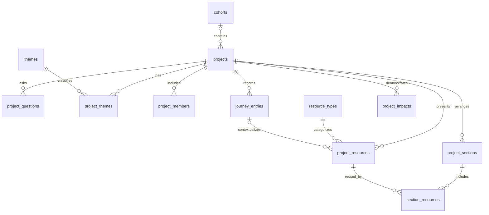

# Dream Journey 数据库设计参考

依据：[Requirements.md](Requirements.md)。本设计以关系型数据库为参考，字段类型采用 PostgreSQL 写法，供后续实现选型使用。

## 1. 设计范围

以项目为核心，支持按届次和主题发现项目、展示研究历程、关联成果、提炼实践建议及呈现影响证据。当前采用人工维护的精选项目机制。

初始版本为九张表；`0002` 新增 `project_questions`，`0003` 新增 `project_sections` 和
`section_resources`，目前共十二张业务表。
成员资料独立于登录账号，适合当前浏览与展示型原型；账号、收藏、评论和投稿审核可在后续扩展。

## 2. 实体关系

一个项目可属于一个已确认的届次，来源未提供时留空；可关联多个主题、问题、成员、研究阶段、成果和影响记录。
一个成果可关联该项目的一个研究阶段，也可只关联项目。

## 3. 表结构

约定：除 `project_themes`、`section_resources` 两张关联表外，每张表都有 `id UUID PRIMARY KEY`、`created_at TIMESTAMPTZ` 和 `updated_at TIMESTAMPTZ`。时间默认取当前时间，`updated_at` 由应用在更新时维护。下列字段默认必填，标注“可空”的除外。

### 3.1 `cohorts`：届次

| 字段 | 类型 | 说明 |
| --- | --- | --- |
| name | TEXT | 届次名称，如“2026 年暑期”，唯一 |
| year | SMALLINT | 年份；允许同一年有多个届次 |
| description | TEXT | 届次介绍，可空 |

### 3.2 `themes`：主题

| 字段 | 类型 | 说明 |
| --- | --- | --- |
| name | TEXT | 主题名称，唯一，如“生态” |
| slug | TEXT | 稳定标识，唯一，如 `ecology` |
| description | TEXT | 主题介绍，可空 |

初始主题包括文化、文化遗产、生态、建筑、博物馆、农业和社区研究。新增主题通过新增记录完成。

### 3.3 `projects`：项目

| 字段 | 类型 | 说明 |
| --- | --- | --- |
| cohort_id | UUID | 外键 → `cohorts.id`，可空；不为缺失届次的资料编造年份 |
| title | TEXT | 项目标题 |
| slug | TEXT | 项目页面标识，唯一 |
| summary | TEXT | 简介，用于列表和搜索 |
| location | TEXT | 调研地点，可空 |
| team_name | TEXT | 团队展示名称，可空 |
| cover_url | TEXT | 封面资源地址，可空 |
| research_question | TEXT | 核心研究问题 |
| research_methods | TEXT | 研究方法概述 |
| learning_outcomes | TEXT | 学习收获 |
| practical_tips | TEXT | 可借鉴的调研方法和实践建议 |
| status | TEXT | `draft`、`published`、`archived`，默认 `draft` |
| published_at | TIMESTAMPTZ | 发布时间；发布前可空 |
| is_demo | BOOLEAN | 是否为示例项目，默认 `true`，用于页面标识 |
| is_featured | BOOLEAN | 是否精选，默认 `false` |
| featured_reason | TEXT | 精选理由，普通项目可空 |
| featured_rank | INTEGER | 精选排序，默认 `0`，数值越大越靠前 |

研究方法、学习收获和实践建议可使用 Markdown 文本；尚未补齐内容的草稿可暂存为空字符串，发布时校验非空白。

### 3.4 `project_themes`：项目与主题关联

| 字段 | 类型 | 说明 |
| --- | --- | --- |
| project_id | UUID | 外键 → `projects.id` |
| theme_id | UUID | 外键 → `themes.id` |

使用 `(project_id, theme_id)` 作为联合主键，避免重复关联。同一项目可以同时属于“生态”和“社区研究”等主题。

### 3.5 `project_members`：项目成员

| 字段 | 类型 | 说明 |
| --- | --- | --- |
| project_id | UUID | 外键 → `projects.id` |
| display_name | TEXT | 展示姓名或昵称 |
| role | TEXT | 项目内角色，如学生、指导教师 |
| school_name | TEXT | 学校名称，可空 |
| sort_order | INTEGER | 展示顺序，默认 `0`，升序 |

本表保存每个项目中的成员展示信息。同一人参与不同项目时可分别记录；后续需要个人主页时再引入统一人员表。

### 3.6 `journey_entries`：研究历程

| 字段 | 类型 | 说明 |
| --- | --- | --- |
| project_id | UUID | 外键 → `projects.id` |
| title | TEXT | 阶段标题，如“社区访谈” |
| description | TEXT | 研究活动、使用的方法与阶段发现 |
| challenges | TEXT | 遇到的困难，可空 |
| responses | TEXT | 应对困难的过程，可空 |
| reflection | TEXT | 该阶段的反思与收获，可空 |
| occurred_on | DATE | 阶段日期，可空 |
| sort_order | INTEGER | 阅读顺序，默认 `0`，升序 |

详情页按照 `sort_order, id` 展示研究历程，允许日期不完整的项目按人工编排顺序讲述。

### 3.7 `resource_types`：成果类型

| 字段 | 类型 | 说明 |
| --- | --- | --- |
| code | TEXT | 稳定类型标识，唯一，如 `report`、`video` |
| name | TEXT | 展示名称，如报告、视频、模型、演示文稿、创意作品 |

成果类型通过表管理，方便新增类型。

### 3.8 `project_resources`：成果与过程资源

| 字段 | 类型 | 说明 |
| --- | --- | --- |
| project_id | UUID | 外键 → `projects.id` |
| journey_entry_id | UUID | 关联的研究阶段，可空；必须属于同一项目 |
| resource_type_id | UUID | 外键 → `resource_types.id` |
| title | TEXT | 资源标题 |
| description | TEXT | 资源说明，可空 |
| resource_url | TEXT | 文件地址或外部作品链接 |
| preview_url | TEXT | 缩略图或预览地址，可空 |
| mime_type | TEXT | 文件媒体类型，可空，如 `application/pdf` |
| sort_order | INTEGER | 展示顺序，默认 `0`，升序 |

文件本体放在对象存储或媒体服务，数据库保存地址和元数据。实体模型可通过图片、视频或在线模型链接展示。

### 3.9 `project_impacts`：影响与证据

| 字段 | 类型 | 说明 |
| --- | --- | --- |
| project_id | UUID | 外键 → `projects.id` |
| category | TEXT | `educational` 或 `social` |
| title | TEXT | 影响标题，如“学生掌握访谈方法” |
| description | TEXT | 具体案例、学习变化或社区反馈 |
| evidence_reference | TEXT | 证据出处，如反馈记录、报告章节；示例项目可空 |
| evidence_url | TEXT | 证据链接，可空 |
| metric_name | TEXT | 可量化指标名称，可空，如“参与工作坊人数” |
| metric_value | NUMERIC | 指标值，可空 |
| metric_unit | TEXT | 指标单位，可空，如“人” |
| metric_scope | TEXT | 统计口径、时间范围及去重方式，可空 |

定量指标字段应全部填写或全部留空。展示真实影响时应提供证据出处；聚合指标前需要统一统计口径，避免同一参与者或同一活动被重复计算。

## 4. 约束与内容生命周期

- 数据库使用外键保证关联有效；`status` 和 `category` 使用 `CHECK` 约束限制取值，排序字段限制为非负数。
- 为 `journey_entries(project_id, id)` 添加唯一约束，再用 `project_resources(project_id, journey_entry_id)` 建立复合外键，保证资源关联的阶段属于同一项目。阶段为空时允许仅关联项目。
- 发布时由应用在同一事务中校验：至少一个主题、一条研究历程、一项成果，以及非空的研究问题、方法、收获和实践建议；同时校验发布时间、精选理由和真实影响的证据出处。
- 公开列表和详情统一限定 `status = 'published'`；首页真实统计同时限定 `is_demo = false`，并使用相同口径查询关联的影响记录。
- 项目下架使用 `archived`，保留历史数据。物理删除项目时，其主题关联、成员、历程、成果元数据和影响记录使用级联删除；资源文件另行处理。
- 届次、主题和成果类型使用 `ON DELETE RESTRICT`，删除前需先调整关联。资源到研究阶段的复合外键使用 `ON DELETE NO ACTION DEFERRABLE INITIALLY DEFERRED`：单独删除阶段前先调整资源关联；项目及其子记录在同一事务中删除时，于提交时检查该约束。

## 5. 查询与索引建议

| 场景 | 建议索引 |
| --- | --- |
| 按届次筛选并按发布时间排序 | `projects(cohort_id, published_at DESC, id DESC) WHERE status = 'published'` |
| 全部公开项目列表 | `projects(published_at DESC, id DESC) WHERE status = 'published'` |
| 按主题查项目 | `project_themes(theme_id, project_id)`；联合主键已覆盖反向查询 |
| 首页精选 | `projects(featured_rank DESC, published_at DESC, id DESC) WHERE status = 'published' AND is_featured = true` |
| 项目详情中的成员、历程和资源 | 三张对应子表分别建立 `(project_id, sort_order, id)` |
| 项目影响记录 | `project_impacts(project_id)` |
| 阶段及类型的外键检查 | `project_resources(project_id, journey_entry_id)`、`project_resources(resource_type_id)` |

原型数据量较小时，关键词搜索可先匹配项目标题与简介。中文搜索规模扩大后，再按分词和相关性需求选择检索方案。新增索引应结合真实查询与数据量评估。

## 6. 典型读取路径

1. **项目列表**：查询已发布项目，按届次及 `project_themes` 筛选，分页返回标题、封面、简介和主题。
2. **项目详情**：按 `slug` 查已发布项目，再分别批量读取成员、主题、研究历程、成果和影响记录，避免多组一对多关联直接联表导致重复行。
3. **首页精选**：筛选已发布的精选项目，按精选排序、发布时间和 ID 降序展示。
4. **影响力概览**：统计已发布的真实项目及其覆盖届次和主题；影响指标按明确口径汇总，并展示证据来源。

## 7. 素材包驱动的扩展（迁移 0002）

`projects` 新增 `background TEXT`（项目起因）、`content_kind TEXT`（未注明、纪实、重构、虚构）、
`content_notice TEXT`（向读者说明内容性质）、`content_tags JSON`（展示标签，默认空数组）。
前三者除 `content_kind` 外可空。`content_kind` 取值为 `unspecified`、`documented`、
`reconstructed`、`fictional`，默认 `unspecified`。`journey_entries.method_tags JSON`
保存阶段的方法标签，默认空数组。

新增 `project_questions`，包含通用 ID、创建/更新时间，以及 `project_id`、可空的 `topic`、
必填且非空白的 `question`、默认零且非负的 `sort_order`。随项目级联删除，按 `sort_order, id` 展示。
原 `research_question` 保留为问题概述，以兼容已有项目。

`project_resources` 在既有资源地址、MIME 类型和阶段关联基础上新增：

| 字段 | 类型 | 用途 |
| --- | --- | --- |
| usage_role | TEXT | `output`、`process`、`reference`，默认 `output` |
| caption / alt_text | TEXT，可空 | 图注与无障碍替代文本 |
| source_name / source_url / original_url | TEXT，可空 | 来源机构、来源网页、原图地址 |
| creator_credit | TEXT，可空 | 已知摄影或作者署名 |
| original_activity / provenance_note | TEXT，可空 | 原活动与本项目的关系、素材性质 |
| rights_status | TEXT | `unconfirmed`、`permission_confirmed`、`open_license`，默认未确认 |
| rights_note | TEXT，可空 | 素材包提供的许可及使用说明 |
| file_size_bytes | BIGINT，可空 | 文件大小，非负 |
| width / height | INTEGER，可空 | 图片尺寸，正数 |
| duration_seconds | NUMERIC(12,3)，可空 | 音视频时长，非负 |

资源类型描述内容形式，`usage_role` 区分展示用途；外部参考图不会因为关联某个阶段而成为本项目现场证据。
发布校验中的“一项成果”限定 `usage_role='output'`，参考图不能独立满足该条件。

本次导入的苗族文化项目标记 `content_kind='reconstructed'`、`is_demo=true`：
保留三个问题、七步过程及五张图片，不虚构届次、学校、姓名、地点、活动日期或影响数据。
最终成果展示原图；三张参考图关联到对应步骤；其他主题海报图仅保留在素材来源中。

## 8. 图文配音更新包（迁移 0003）

后端存储完整的内容对应关系，前端不按文件名推断位置。

### project_sections：有序内容段落

除通用 ID 和时间字段外，包含 `project_id`、项目内唯一的 `key`、`kind`、`title`、`body`、
非负的 `sort_order`，以及可空的 `journey_entry_id`。
`kind` 为 `opening`、`journey`、`output`、`learning` 或 `other`；过程段落必须关联研究步骤。
使用延迟复合外键 `(project_id, journey_entry_id)` 保证步骤属于同一项目。

本数据集保存 `opening`、`step-1` 至 `step-7`、`output`、`learning` 十个段落。
开场配音是 01，七步过程使用 02—08，成果和收获使用 09、10。

### section_resources：段落与媒体关联

以 `(section_id, resource_id)` 为联合主键，另存 `project_id`、`role`、`is_optional` 和 `sort_order`。
`role` 为 `illustration`、`narration` 或 `attachment`。
两组复合外键分别引用同一项目的段落和资源，防止跨项目配对，父记录删除时级联删除。
第六步的其他主题海报标记为可选；第七步和成果段落共用同一资源 ID，不重复存储成品图。

### 资源与导入修订

`project_resources` 新增 `transcript TEXT`、`is_ai_generated BOOLEAN DEFAULT false`、
`generation_note TEXT`、`sha256 TEXT` 和 `import_key TEXT`。除布尔值外可空。
已有 `duration_seconds NUMERIC(12,3)` 保存配音时长。台词单独保存，不含来源或版权说明。
资源的 `(project_id, id)` 和 `(project_id, import_key)` 分别唯一，便于复合外键及原位更新。

`journey_entries.import_key` 为可空的项目内唯一导入标识。
`projects` 新增可空的 `opening_question`、`dataset_key`、`dataset_version`、`dataset_digest`、
`dataset_imported_at`，分别保存开场问题、数据集标识、版本、内容摘要和 UTC 导入时间。

新版本以原项目 ID 升级包内文案、图片和配音关系，复用旧步骤、旧图片的 ID。
相同内容摘要的重复导入不覆盖后续编辑；低版本数据不会反向覆盖高版本。
校验和更新在一次数据库事务中完成，失败时恢复原来的发布状态与内容关联。

当前素材有六张图片、十段 AI 合成音频，音频总长 177.840 秒。
独立前端使用 `/api/v1/projects/{slug}` 的 `sections` 或单独的 `/sections` 接口，约定见
[backend/API.md](backend/API.md)。

## 9. 第二个数据集与文档表格资源（迁移 0004）

丹噶尔古城作为独立项目导入，数据集 key 为 `dangar-old-town`，数据版本为 1；苗族项目仍为独立的
`miao-culture` 版本 2。两包分别使用目录与导入标识前缀，复用文件名不会导致资源串用。
示例适配器选择各自媒体目录、版本和命名空间，再调用通用导入器，不将第二包覆盖到第一项目。

业务表数量仍为十二张。`projects.short_title TEXT` 可空，保存列表短标题。
`project_resources` 新增可空的 `content_text TEXT` 与 `structured_data JSON`。
Markdown 保留正文；CSV 的结构化格式为 `{columns: [字符串...], rows: [[字符串...], ...]}`。
文件本体原样保留，表格单元格不自动转数值或改变事实判断。正文及表格与原文件的一致性在导入前检查。

第二包共 18 个资源：4 张图片、10 段配音及4份文本/表格文件。
发现卡和比较表属于成果；已知与待确认表属于过程资料；文字来源表属于参考资料。
十一段内容中前十段分别为开场、七步、成果和收获，最后一段为无配音的来源说明。
前端按 `sections` 内容迭代，不硬编码段数、步骤数或所有段落都必须有音频。

图片、配音的 AI 属性与表格的事实状态分别保存。参考照片和厅署门楼不成为具体马厩或喂马安排的证据，
现代“服务区”类比也不被登记成历史名称。该项目保持 `is_demo=true`，不计入真实项目影响统计。

## 10. 核心与数据来源分离（迁移 0005）

`dream_journey/` 只维护平台领域模型、事务、通用清单及 API，不包含当前素材包名称或注册表。
`examples/` 单向依赖核心，保存两个 ZIP 的解析、旧清单转换、固定配音布局校验及种子数据。
未来数据来源可直接生成 [通用清单](backend/MANIFEST.md)，无需修改核心代码。
前文的三问题、七步和配音数量均为具体示例内容，不是表结构或通用导入规则。

清单允许任意步骤、段落 key、非负排序、可空段落列表及没有配音的内容。
成果类型通过 `resource_types` 目录扩展；资源可来自指定本地目录或远程 HTTP(S) 地址。
通用导入不会猜测封面文件名，不自动设置精选、示例标识或来源说明；新项目默认草稿，
`is_demo` 沿用领域模型默认值 true，可显式改为 false。发布仍遵守平台完整性和证据规则。

`0005` 为 `project_questions` 新增可空 `import_key TEXT` 和唯一约束
`(project_id, import_key)`，与步骤、资源使用相同的稳定标识原则。
问题重写或重新排序后仍可更新原记录，旧记录在明确匹配后补充标识。
导入保持事务原子性及版本防回退，未列出的人工记录保留。

HTTP 启动只在 `--migrate` 时升级结构，不自动创建目录或导入示例；
媒体根目录和联调页目录显式配置。空库可启动，默认核心测试不依赖示例文件。
